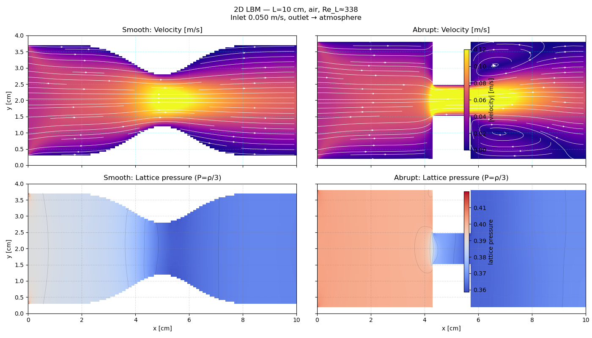

# Constricted Channel Flow with the Lattice Boltzmann Method

2-D simulation of air flowing through a duct that contains either a smooth (Venturi-like) or an abrupt constriction.  
The code uses the D2Q9 lattice Boltzmann method, is dimensionally scaled to a 10 cm duct, and reports static-pressure recovery.

## Physical setup

| Quantity              | Value                          |
|-----------------------|--------------------------------|
| Length L              | 10 cm                          |
| Height H              | 4 cm                           |
| Fluid                 | air                            |
| Density rho           | 1.225 kg/m^3                   |
| Viscosity mu          | 1.81e-5 Pa.s                   |
| Inlet velocity u_in   | 0.05 m/s                       |
| Reynolds number Re_L  | approx. 338                    |
| Outlet                | atmospheric pressure           |

## Lattice Boltzmann Method (D2Q9) – brief introduction

The lattice Boltzmann method (LBM) solves a discrete-velocity Boltzmann equation instead of the Navier–Stokes equations directly.

On a square lattice the nine discrete velocities (D2Q9) are:

    c_i = (0,0)                  for i = 0
    c_i = (±1, 0) or (0, ±1)     for i = 1..4
    c_i = (±1, ±1)               for i = 5..8

with weights

    w_0 = 4/9
    w_1..4 = 1/9
    w_5..8 = 1/36

The central quantity is the particle distribution function f_i(x, t).  
Macroscopic density and velocity are recovered by moments:

    rho = sum_{i=0 to 8} f_i
    rho * u = sum_{i=0 to 8} c_i * f_i

### Collision (BGK)

    f_i* = f_i - (1/tau) * (f_i - f_i^eq)

where the equilibrium distribution is

    f_i^eq = w_i * rho * [ 1 + 3*(c_i · u) + (9/2)*(c_i · u)^2 - (3/2)*|u|^2 ]

The relaxation time tau is related to the kinematic viscosity by

    nu = (1/3) * (tau - 1/2)

(c_s^2 = 1/3 in lattice units).

### Streaming

    f_i(x + c_i, t+1) = f_i*(x, t)

Solid walls are treated by the simple bounce-back rule  
f_opposite = f_i  (where opposite is the reverse direction).

### Pressure

In the LBM equation of state the static pressure is simply

    P = rho / 3

## Pressure-recovery definitions used in the code

Let  
- P_up  = average static pressure well upstream  
- P_th  = static pressure at the throat (location of maximum speed)  
- P_dn  = average static pressure well downstream  

Then

    throat drop     = P_up - P_th
    recovered       = P_dn - P_th
    recovery ratio  = (P_dn - P_th) / (P_up - P_th)
    net loss        = P_up - P_dn

The ideal kinetic-energy recovery (Bernoulli) is

    delta_P_ideal = (1/2) * rho * (u_th^2 - u_dn^2)

and the recovery efficiency is

    eta = (P_dn - P_th) / delta_P_ideal

(Because the exit is open to atmosphere, eta is often negative; the useful figure of merit is the net loss.)

## Example results (Re_L ≈ 338)

=== Smooth pressure recovery ===
  Upstream P   = 0.39157
  Throat P     = 0.37778  (x=5.3 cm)
  Downstream P = 0.38073
  Throat drop  = 0.01379
  Recovered    = 0.00295
  Recovery ratio = 0.214
  Net loss     = 0.01084
  Ideal KE recovery = 0.00579
  Recovery efficiency = 0.510

=== Abrupt pressure recovery ===
  Upstream P   = 0.40200
  Throat P     = 0.37108  (x=4.8 cm)
  Downstream P = 0.36774
  Throat drop  = 0.03092
  Recovered    = -0.00333
  Recovery ratio = -0.108
  Net loss     = 0.03426
  Ideal KE recovery = 0.01525
  Recovery efficiency = -0.219

### Brief discussion

Both geometries discharge to a fixed atmospheric pressure, so a large positive pressure rise from throat to exit is not expected. The useful comparison is the sign of the recovery and the size of the net loss.

- Smooth: recovery ratio = +0.214 and efficiency = +0.510.  
  After the throat the static pressure rises a little; about half of the ideal Bernoulli recovery is realized. Net loss is modest (0.011).

- Abrupt: recovery ratio = -0.108 and efficiency = -0.219.  
  After the throat the static pressure continues to fall. Separation and recirculation dissipate kinetic energy, so there is no recovery. Net loss is more than three times larger (0.034).

The factor-of-three difference in net loss quantifies the extra total-pressure penalty caused by the abrupt expansion.

## Running the code

    python3 lbm_constricted_flow.py

Requires only NumPy and Matplotlib.  
It produces lbm_constricted_flow.png and prints the pressure-recovery tables for both geometries.

## Expected behaviour

- Smooth constriction – flow stays attached; good static-pressure recovery.  
- Abrupt constriction – clear laminar recirculation zones form immediately downstream of the sudden expansion; larger net pressure loss.

## References

- Krüger et al., The Lattice Boltzmann Method, Springer, 2017.  
- Succi, The Lattice Boltzmann Equation, Oxford, 2001.
